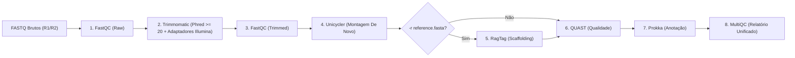

# run_assembly.py

Pipeline automatizado e **offline-first** para controle de qualidade, trimagem, montagem *de novo*, scaffolding opcional e anotação de genomas bacterianos via linha de comando.

**Autor:** Andrei Giacchetto Felice
**Instituição:** Laboratory of Immunology and Bioinformatics — Federal University of Triângulo Mineiro (UFTM)
**Versão:** 2.0

---

## Fluxo do Pipeline



### Etapas incluídas

1. **`fastqc_raw`**: Análise de qualidade das leituras brutas.
2. **`trimmomatic`**: Remoção automática de adaptadores Illumina (`TruSeq3-PE-2.fa`, `TruSeq3-PE.fa` ou `NexteraPE-PE.fa`, detectados no ambiente Conda/sistema) e corte por qualidade (`LEADING:20 TRAILING:20 SLIDINGWINDOW:4:20 MINLEN:30`).
3. **`fastqc_trimmed`**: Verificação de qualidade após a trimagem (`*_1P.fastq.gz` e `*_2P.fastq.gz`).
4. **`unicycler`**: Montagem *de novo* a partir das leituras pareadas trimadas.
5. **`ragtag`** *(opcional)*: Scaffolding guiado por genoma de referência (executado automaticamente quando `-r / --reference` é informado).
6. **`quast`**: Métricas de qualidade da montagem (`N50`, `L50`, tamanho total, GC%, etc.).
7. **`prokka`**: Anotação funcional rápida de genomas procariotos (`.gbk`, `.gff`, `.faa`, `.fna`, etc.).
8. **`multiqc`** *(opcional)*: Consolida todos os relatórios do FastQC, Trimmomatic, QUAST e Prokka em um único HTML interativo.

---

## Instalação e Dependências

O script utiliza apenas a biblioteca padrão do Python 3 (sem dependências `pip` extras) e executa as ferramentas bioinformáticas instaladas no seu ambiente **Conda/Mamba** (100% offline).

### 1. Verificar ferramentas instaladas

```bash
python run_assembly.py --check-deps
```

Se alguma ferramenta estiver ausente, o script exibirá exatamente o comando `conda`/`mamba` necessário para instalá-la.

### 2. Instalação recomendada via Conda / Mamba

```bash
conda create -n assembly_env -c bioconda -c conda-forge \
  fastqc trimmomatic unicycler quast prokka ragtag multiqc -y

conda activate assembly_env
```

> **Dica:** Você também pode usar `--auto-install` ao rodar o script caso tenha `mamba` ou `conda` configurado e acesso à internet no momento da instalação.

---

## Como Usar

### Execução padrão (todas as amostras em subpastas ou na pasta atual)

```bash
python run_assembly.py -i ./minhas_amostras -t 8
```

### Com genoma de referência (ativa RagTag + comparação no QUAST)

```bash
python run_assembly.py -i ./minhas_amostras -r referencia.fasta -t 8
```

### Modo simulação (`--dry-run`)

Mostra todos os comandos que seriam executados sem rodar nada nem criar arquivos:

```bash
python run_assembly.py -i ./minhas_amostras --dry-run
```

### Rodar ou pular etapas específicas

```bash
# Rodar apenas trimagem e montagem
python run_assembly.py -i ./minhas_amostras --steps trimmomatic,unicycler -t 8

# Rodar pipeline completo pulando o Prokka e o MultiQC
python run_assembly.py -i ./minhas_amostras --skip prokka,multiqc -t 8

# Ajustar Phred mínimo para 25 e tamanho mínimo de leitura para 70 pb
python run_assembly.py -i ./minhas_amostras --phred 25 --minlen 70

# Forçar reexecução mesmo se os arquivos de saída já existirem
python run_assembly.py -i ./minhas_amostras --force
```

---

## Padrões de Arquivos Suportados

O script detecta automaticamente pares de leituras pareadas (`.fastq.gz` ou `.fq.gz`) nos formatos mais comuns:

- `AMOSTRA_L001_R1_001.fastq.gz` / `AMOSTRA_L001_R2_001.fastq.gz`
- `AMOSTRA_R1_001.fastq.gz` / `AMOSTRA_R2_001.fastq.gz`
- `AMOSTRA_R1.fastq.gz` / `AMOSTRA_R2.fastq.gz`
- `AMOSTRA_1.fastq.gz` / `AMOSTRA_2.fastq.gz`
- `AMOSTRA_1P.fastq.gz` / `AMOSTRA_2P.fastq.gz` *(leituras já trimadas — pula o Trimmomatic automaticamente)*

Se houver **uma amostra por subpasta**, os resultados são salvos dentro da respectiva subpasta. Se houver **várias amostras na mesma pasta**, o script cria automaticamente `<AMOSTRA>_results/` para evitar sobrescrita.

---

## Estrutura de Saída

```text
amostra_01/
├── fastqc_raw/              # Relatórios FastQC das leituras brutas
├── trimmomatic_result/      # Leituras trimadas (*_1P, *_2P, *_1U, *_2U)
├── fastqc_trimmed/          # Relatórios FastQC após trimagem
├── unicycler_result/        # assembly.fasta, assembly.gfa, unicycler.log
├── ragtag_result/           # ragtag.scaffold.fasta (se -r for informado)
├── quast_result/            # report.txt, report.html, etc.
└── prokka_result/           # <amostra>.gbk, <amostra>.gff, <amostra>.faa, etc.
```

Além disso, um arquivo de log completo (`run_assembly_YYYYMMDD_HHMMSS.log`) e o relatório agregado `multiqc_report/` são salvos no diretório de entrada.

---

## Sobre o RagTag: Quando Usar?

O **RagTag** (`ragtag.py scaffold`) ordena e orienta os contigs gerados pelo Unicycler usando um genoma de referência próximo, unindo-os com lacunas (`N`s).

- **Use (`-r referencia.fasta`)** quando você tiver uma cepa/espécie muito próxima e quiser scaffolds em nível cromossômico para visualizar sintenia ou facilitar análises comparativas.
- **Não use** (omita `-r`) se a referência for distante ou se houver chance de rearranjos genômicos estruturais importantes na sua amostra — nesses casos, os contigs *de novo* do Unicycler são mais fiéis e evitam quimeras artificiais.

---

## Opções Principais (`--help`)

| Flag                     | Descrição                                                                |
| :----------------------- | :------------------------------------------------------------------------- |
| `-i, --input DIR`      | Diretório de entrada com os arquivos FASTQ (padrão: `.`)               |
| `-r, --reference FILE` | Genoma de referência em FASTA (ativa RagTag e referência no QUAST)       |
| `-t, --threads N`      | Número de threads de CPU (padrão: até 8)                                |
| `--phred N`            | Qualidade Phred mínima no Trimmomatic (padrão: `20`)                   |
| `--minlen N`           | Comprimento mínimo da leitura após trimagem (padrão: `30`)            |
| `--adapters FILE`      | Caminho manual para o FASTA de adaptadores Illumina                        |
| `--steps LISTA`        | Lista de etapas separadas por vírgula                                     |
| `--skip LISTA`         | Etapas a pular separadas por vírgula                                      |
| `--force`              | Sobrescreve saídas existentes (por padrão o script retoma de onde parou) |
| `--check-deps`         | Verifica ferramentas instaladas e exibe comandos de instalação           |
| `--auto-install`       | Tenta instalar dependências ausentes via `mamba`/`conda`              |
| `--dry-run`            | Simula a execução imprimindo os comandos sem rodar nada                  |
